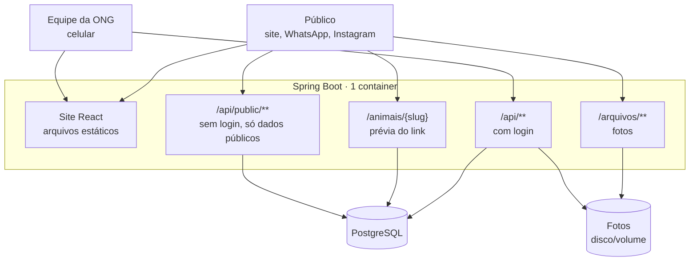
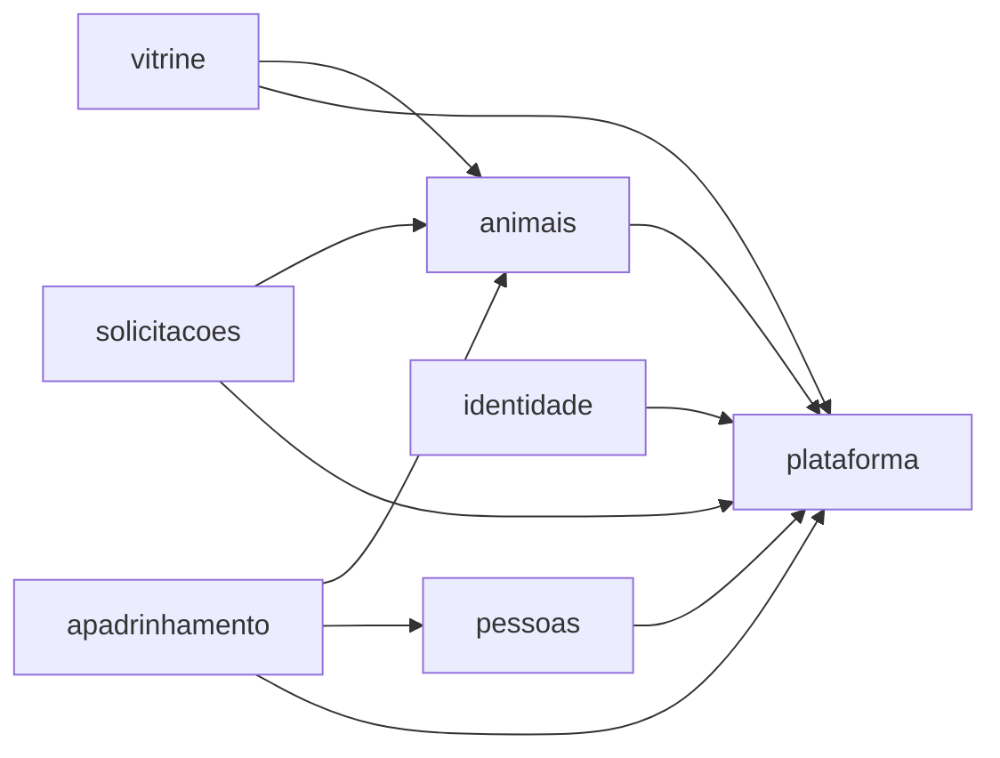
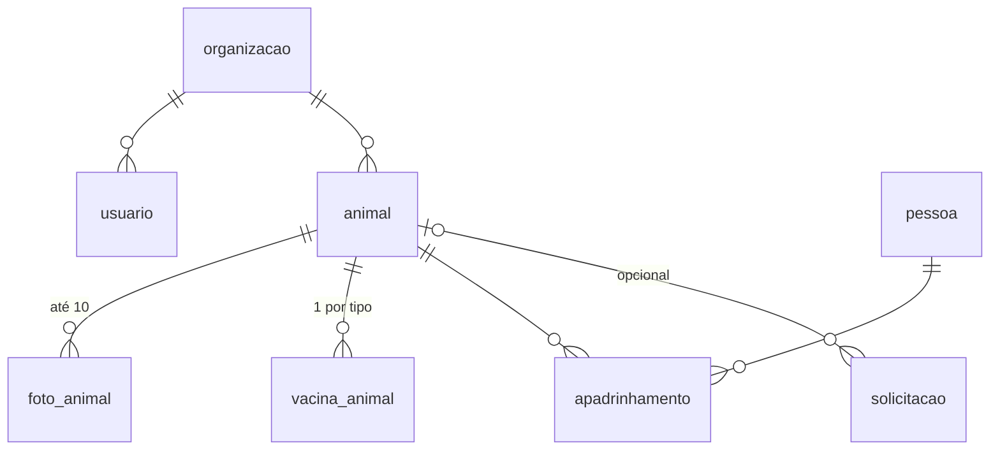

# Arquitetura

Como o sistema é construído e por quê. As decisões que justificam cada escolha estão em
[`adr/`](adr/README.md); as regras do domínio, em [`regras-de-negocio.md`](regras-de-negocio.md);
o contrato HTTP, em [`api.md`](api.md).

> **Situação (07/11/2026):** backend e frontend completos para a Fase 1 em ambiente local; vitrine
> ligada à API; painel em integração. **Hospedagem de produção ainda não decidida.**

## 1. Visão geral

Um **único serviço** Spring Boot entrega o site (build do React) e a API. Um PostgreSQL guarda os
dados; as fotos ficam num armazenamento de arquivos. ([ADR 0005](adr/0005-monolito-modular.md))



**Por que um só serviço e um só endereço:**

- um serviço para hospedar e pagar;
- front e API na **mesma origem**: o login por cookie e a proteção CSRF funcionam sem CORS
  ([ADR 0006](adr/0006-sessao-com-cookie.md));
- a prévia do link no WhatsApp sai do próprio Spring (`OpenGraphController`), sem Next.js.

> Consequência importante: **em produção o front não pode ficar num domínio separado da API**
> (ex.: front na Vercel e API em outro lugar). O cookie de sessão e o CSRF param de funcionar e a
> prévia do WhatsApp deixa de existir. O front não tem mais modo demonstração
> ([ADR 0011](adr/0011-fim-do-modo-demonstracao.md)): sem a API, ele não funciona.

## 2. Stack

| Camada | Tecnologia |
|---|---|
| Backend | Java 25 ([ADR 0008](adr/0008-java-25.md)), Spring Boot 4.1, Spring Modulith 2.1, Spring Security, JPA/Hibernate |
| Banco | PostgreSQL 17 + Flyway (migrations versionadas em `backend/src/main/resources/db/migration`) |
| Frontend | React 19 + Vite, JavaScript ([ADR 0003](adr/0003-javascript-no-frontend.md)), react-router 7, Bootstrap 5 (só CSS) |
| Testes | JUnit 5, AssertJ, Testcontainers (Postgres real), MockMvc, Spring Modulith `verify()` |
| Qualidade do front | ESLint + Prettier |
| CI | GitHub Actions: `mvnw verify` + lint/formatação/build do front a cada push na `main` e em todo PR |
| Ambiente local | Docker Compose (Postgres na porta **5433**) + Maven Wrapper + Vite (proxy de `/api` e `/arquivos`) |

## 3. Backend: monólito modular

Cada módulo é um pacote de primeiro nível em `br.org.abrigo`. O que está no pacote raiz é a **API
pública** do módulo; o que está em `internal/` só ele enxerga. O `ModularidadeTest` quebra o build
se alguém atravessar essa fronteira.

| Módulo | Responsabilidade | Depende de |
|---|---|---|
| `plataforma` | Entidade base (id, versão, auditoria), erros padronizados, paginação, armazenamento de arquivos, servir o React | — |
| `identidade` | Usuários da equipe, login por sessão, regras de acesso | plataforma |
| `animais` | Cadastro, fotos, vacinas tomadas, situação, visibilidade na vitrine | plataforma |
| `pessoas` | Cadastro único de pessoas (padrinho hoje, adotante na Fase 2) | plataforma |
| `apadrinhamento` | Vínculo pessoa ↔ animal (N:N), tipo de apoio | plataforma, animais, pessoas |
| `solicitacoes` | Formulário público de interesse + caixa de solicitações da equipe | plataforma, animais |
| `vitrine` | API pública dos animais e prévia de link (Open Graph) | plataforma, animais |



### Camadas dentro de um módulo

```
animais/
├── AnimalService.java       API pública do módulo (o que os outros módulos podem chamar)
├── AnimalResumo.java ...     records públicos (nunca a entidade)
└── internal/
    ├── GestaoAnimais.java    casos de uso: transação, orquestração
    ├── domain/               entidades com as REGRAS (testadas sem Spring e sem banco)
    ├── persistence/          repositórios Spring Data e filtros (Specification)
    └── web/                  controllers: só traduzem HTTP ↔ caso de uso e validam formato
```

Convenções que valem para todo módulo:

- **Regra de negócio fica na entidade** (`Animal`, `Apadrinhamento`, `Pessoa`, `Solicitacao`), não
  no controller nem no service. Violação vira `RegraNegocioException` → HTTP **422**.
- Validação de **formato** (obrigatório, tamanho, data no passado) fica no request com Bean
  Validation → HTTP **400** com `campos` por campo.
- Entre módulos, referência **só por id**: nada de `@ManyToOne` atravessando módulos. As chaves
  estrangeiras existem só no banco.
- A API **nunca devolve a entidade**: sempre um record de resposta.
- **Bloqueio otimista**: o `PUT` envia a `versao` que a tela carregou; se alguém salvou antes, **409**.
- **Auditoria**: `criado_em/por` e `atualizado_em/por` preenchidos automaticamente.
- `organizacao_id` em todas as tabelas (fixo em 1): porta aberta para várias ONGs, sem custo agora.
- Comunicação assíncrona por **evento** do Spring Modulith (ex.: `SolicitacaoRecebida`), com
  registro em banco (`event_publication`) para não perder evento se a aplicação cair.
- Datas de negócio usam o `Clock` com fuso `America/Sao_Paulo`.

### Formato de erro

Todas as respostas de erro seguem *Problem Details*: `{ title, status, detail, campos? }`.
O front mostra `detail` ao usuário e `campos` ao lado de cada campo do formulário.

## 4. Modelo de dados



| Tabela | Migration | Observação |
|---|---|---|
| `organizacao`, `usuario` | V1 | e-mail único sem diferenciar maiúsculas |
| `animal`, `foto_animal` | V2 | `slug` imutável (URL pública); dois chips únicos; `castrado` aceita nulo |
| `pessoa` | V3 | CPF opcional e único; telefone ou e-mail obrigatório |
| `apadrinhamento` | V4 | no máximo um vínculo **ativo** por pessoa + animal (índice parcial) |
| `solicitacao` | V5 | registro do consentimento (LGPD) |
| `vacina_animal` | V6 | sem histórico ([ADR 0010](adr/0010-vacinas-no-cadastro.md)) |

> **Regra de migrations:** até o primeiro deploy de produção, migrations ainda podem ser editadas
> (recriando o banco local com `docker compose down -v`). **Depois do primeiro deploy, migration
> aplicada é congelada**: toda mudança é uma nova versão (V7, V8...).

## 5. Segurança e LGPD

| Camada | Como |
|---|---|
| Acesso | `/api/public/**`, `/api/auth/csrf` e `/actuator/health` abertos; todo o resto de `/api/**` exige sessão. Uma regra só, em `SegurancaConfig` |
| Login | `formLogin` em `/api/auth/login`; sessão em cookie `httpOnly`, `SameSite=Lax`, `Secure` em produção; expira em 8 h |
| CSRF | cookie `XSRF-TOKEN` → header `X-XSRF-TOKEN` em todo POST/PUT/DELETE (o `cliente.js` do front faz isso sozinho) |
| Senha | BCrypt com prefixo de algoritmo (`{bcrypt}...`); de 8 caracteres a 72 bytes (limite do BCrypt) |
| Perfis | administrador (gerencia a equipe: `/api/usuarios/**` com `hasRole("ADMIN")`) e equipe ([ADR 0012](adr/0012-perfil-administrador.md)) |
| Força bruta no login | bloqueio permanente no banco: e-mail+IP após 5 erros seguidos, IP inteiro após errar 3 e-mails em 1h; conta recusa por 15 min após 10 erros de qualquer IP; resposta e tempo iguais aos de senha errada (piso de 400 ms em toda recusa) ([ADR 0013](adr/0013-bloqueio-de-login.md)) |
| Nomes nas telas | a auditoria grava o login (e-mail); as telas mostram o nome da pessoa, traduzido pela interface `NomesDaEquipe` (plataforma), implementada pelo módulo identidade |
| IP do visitante | `IpDoCliente`, modo em `IP_CLIENTE_MODO`; o `X-Forwarded-For` não é aceito cegamente (`forward-headers-strategy: none`) |
| Dados públicos | **barreira dupla**: `AnimalVitrine` (módulo animais) e `AnimalPublicoResponse` (vitrine) só têm campos públicos; o teste `ApiPublicaSemDadosSensiveisTest` falha se chip, ala, canil, CPF, telefone, e-mail ou endereço aparecerem numa rota pública |
| Formulário público | consentimento obrigatório, campo isca contra robôs, limite de envios por IP/hora |
| Upload | tipo de imagem conferido pelos bytes (não pelo que o navegador diz); máximo 3 MB; o celular já comprime |
| Segredos | só variáveis de ambiente (`.env.example` documenta); nada versionado |

## 6. Frontend

```
frontend/src/
├── api/          ÚNICA camada que fala com o backend (cliente.js: cookie + CSRF + erros)
├── components/   layout, pets, painel, ui (Campos, Folha, CarregarMais...)
├── hooks/        useCarregar, usePaginacao, useRolagemRestaurada
├── pages/        publico/ (vitrine, ficha, formulários) e painel/ (equipe)
└── styles/       tema.css: tokens do guia de design (docs/DESIGN.md)
```

- **Todos os dados vêm do banco**, pela API ([ADR 0011](adr/0011-fim-do-modo-demonstracao.md)). As
  telas só chamam funções de `src/api/`, nunca `fetch` direto.
- **Listas se atualizam sozinhas**: depois de toda gravação bem-sucedida, o `cliente.js` avisa as
  telas abertas (`EVENTO_DADOS`) e o `useCarregar` busca de novo, sem piscar a tela.
- **Mobile-first**: a equipe cadastra pelo celular. Fotos comprimidas no aparelho (1600 px, WebP,
  sem dados de GPS) antes do envio.
- **Listas longas** paginadas no backend; a tela soma páginas com "Carregar mais" e guarda na URL
  quantas páginas estavam abertas (`?ate=3`) para voltar da ficha sem perder a posição.
- Fontes e ícones empacotados no build (sem CDN): funcionam com rede instável.
- Guia visual: [`frontend/docs/DESIGN.md`](../frontend/docs/DESIGN.md). Detalhes do front:
  [`frontend/docs/GUIA_FRONTEND.md`](../frontend/docs/GUIA_FRONTEND.md).

## 7. Build, deploy e operação

### Imagem de produção

`Dockerfile` em 3 estágios: build do React (Node) → build do jar com o React embutido em
`static/` (Maven) → imagem final só com a JRE e o jar, rodando como usuário sem privilégios.
A JVM usa no máximo 75% da memória do container.

### Configuração (variáveis de ambiente)

| Variável | Produção |
|---|---|
| `DB_URL`, `DB_USER`, `DB_PASSWORD` | banco gerenciado |
| `ADMIN_NOME`, `ADMIN_EMAIL`, `ADMIN_SENHA` | primeiro usuário (só criado se não houver nenhum) |
| `URL_PUBLICA` | domínio público (usado nas prévias do WhatsApp) |
| `ARMAZENAMENTO_DIR` | pasta das fotos, **num volume persistente** ([ADR 0007](adr/0007-armazenamento-atras-de-interface.md)) |
| `COOKIE_SECURE` | `true` |
| `SOLICITACOES_LIMITE_HORA` | antispam do formulário |
| `PORT` | definido pela plataforma |

### Saúde e logs

`/actuator/health` (com *probes* de liveness/readiness) para a plataforma saber se a aplicação
subiu. Logs em saída padrão.

### Backup

- `pg_dump` diário, guardado fora da plataforma do banco, retenção de 30 dias.
- Fotos: cópia do volume (ou do bucket, se migrar para R2/S3).
- **Teste de restauração** antes da entrega e periodicamente: backup nunca restaurado não é backup.

### Pendências de produção

| Item | Situação |
|---|---|
| Hospedagem | em decisão (próxima ADR) |
| Domínio | o `abrigoanimal.org.br` não é da ONG: registrar um novo em nome da ONG |
| Backup automatizado | a implementar junto com a hospedagem |
| Estágio do front no `Dockerfile` | descomentar (o build não precisa de variável) |

## 8. Como rodar localmente

Ver o [README](../README.md#rodando-localmente). Em resumo: Docker aberto e JDK 25 →
`docker compose up -d` → `backend/.\mvnw.cmd verify` → `.\mvnw.cmd spring-boot:run` com
`ADMIN_EMAIL`/`ADMIN_SENHA` → em `frontend/`, `npm install` e `npm run dev`.

Carga das planilhas da ONG: `backend/scripts/importar_planilhas.py` (o SQL gerado fica em
`backend/dados/`, fora do git).

Dados fictícios para testar as telas (gato, óbito, adotado, oculto, padrinhos, pedidos em todos os
status): `backend/scripts/dados-teste.sql`; para tirar, `limpar-dados-teste.sql`. Os dois mexem só
no que tem `criado_por = 'dados-teste'`. O modo de rodar está no cabeçalho de cada arquivo.
